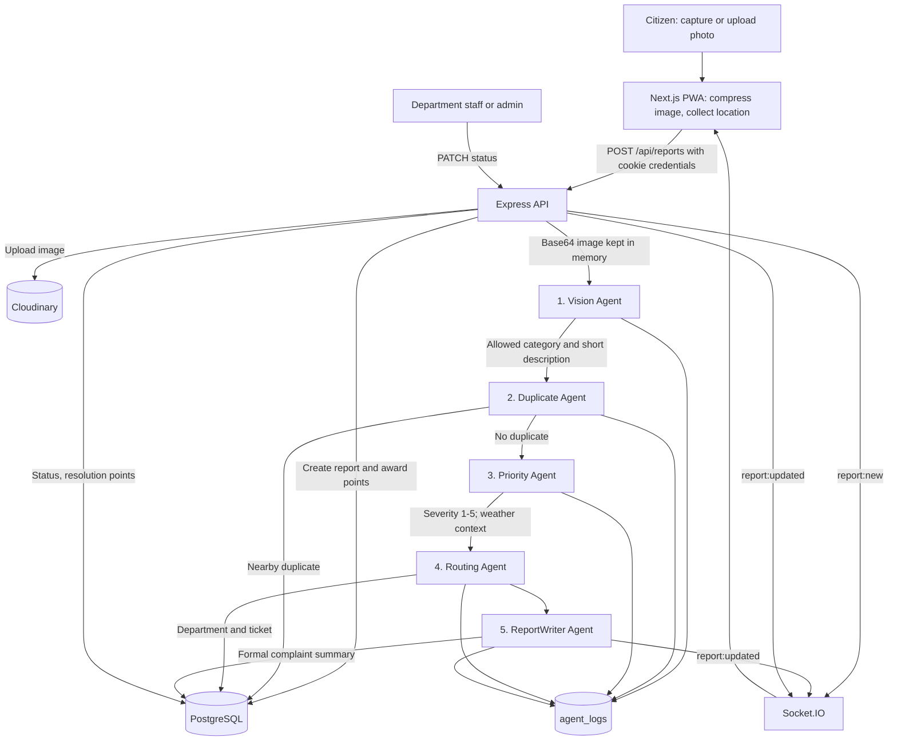

# SolveKey architecture

SolveKey is a mobile-first civic issue reporting PWA. The Next.js App Router frontend calls an Express API using cookie credentials and receives live report updates over Socket.IO. PostgreSQL stores users, reports, agent traces, point events, and departments. Production report images are stored in Cloudinary; local development falls back to `backend/uploads/` and serves them from `/uploads`. The resulting image URL is stored in PostgreSQL.

The backend starts without Gemini credentials; submitting a report still stores it, but the assistant and report analysis are unavailable until a valid `GEMINI_API_KEY` is provided.

## Agent pipeline

The pipeline uses the configured Gemini model through `backend/src/agents/gemini.js`. The Vision step receives the submitted base64 image transiently; the database stores only the image URL. Agent outputs and errors are recorded in `agent_logs` and can be retrieved through the report trace endpoint. The duplicate detector may mark a new report as a duplicate and increment the original report's upvotes. A successful pipeline emits `report:updated` when classification, severity, and routing are available.

The priority agent also obtains weather context from Open-Meteo. Routing uses the local department/ticket tools. Department staff and admins can update a report to `reported`, `in_progress`, or `resolved`; resolving a report awards the reporter a one-time 20-point bonus.

## Main components

- `frontend/`: Next.js, TypeScript, Tailwind CSS, PWA manifest/service worker, cookie-auth API client, and Socket.IO client.
- `backend/src/index.js`: Express server, CORS, security middleware, API routers, and Socket.IO server.
- `backend/src/reports.js`: report creation, listing, trace, upvote, leaderboard, and status routes.
- `backend/src/stats.js`: role-restricted operational aggregates.
- `backend/src/agents/orchestrator.js`: sequential five-agent workflow.
- `backend/db/schema.sql`: PostgreSQL tables and idempotent schema additions.

The frontend's `NEXT_PUBLIC_API_URL` points to the deployed backend origin. The backend's `FRONTEND_URL` is the exact allowed browser origin. Both REST and Socket.IO use credentialed CORS.
